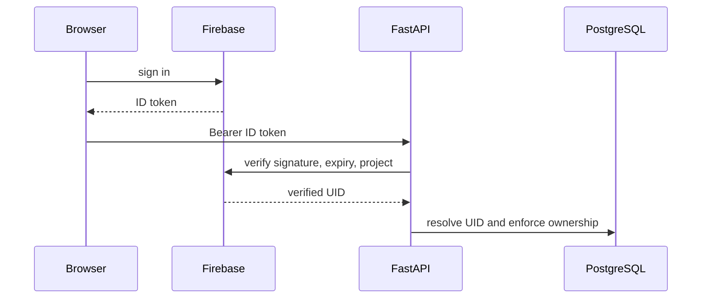

# Authentication flow

The browser Firebase SDK handles email/password, Google popup login, verification, token refresh, password reset, and logout. It sends a short-lived Firebase ID token to FastAPI. Firebase Admin verifies signature and `aud` against `FIREBASE_PROJECT_ID`; endpoints must resolve the verified UID to PostgreSQL. Client-supplied UIDs are never trusted.

## Verified email and display name

- Login and signup validate the email format in the browser first (`noValidate` form with the app's own message). Wrong password and unknown email share one message ("Those sign-in details did not match..."), which keeps Firebase email-enumeration protection meaningful; keep that setting enabled in the Firebase console (Authentication > Settings > User actions).
- Password signup calls `sendEmailVerification`. The screen explains how to check the inbox, resend, or correct a typo. A typo correction uses `verifyBeforeUpdateEmail` (the link goes to the new address) because `updateEmail` is rejected when enumeration protection is on. Firebase may ask for a fresh sign-in after an address change.
- "I verified, check again" runs `reload(user)` and `getIdToken(true)` so the next API call carries `email_verified: true`. The backend re-checks the claim on every account route (`/auth/*`, `/chat` in account mode, `/conversations*`, `/memories*`, `/memory-settings`) and returns 403 "Verify your email..." otherwise. Quick Chat needs no account. Google sign-in accounts arrive verified.
- Existing unverified password accounts that open account chat or Memories see the verify screen (not a raw error) and can resend the link.
- The sidebar shows the Firebase profile display name, or "Your account" when none exists. A name is never derived from the email address. The backend stores the `name` claim and passes it to the model as a trusted profile field to be used occasionally.
