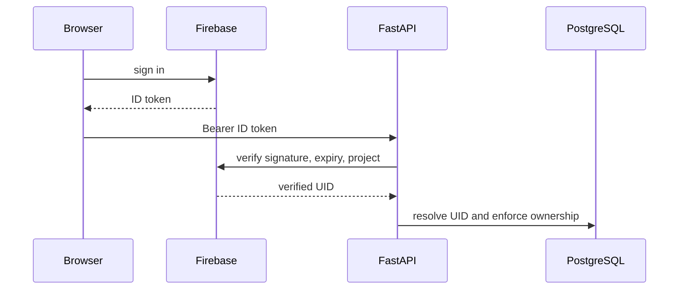

# Authentication flow

The browser Firebase SDK handles email/password, Google popup login, verification, token refresh, password reset, and logout. It sends a short-lived Firebase ID token to FastAPI. Firebase Admin verifies signature and `aud` against `FIREBASE_PROJECT_ID`; endpoints must resolve the verified UID to PostgreSQL. Client-supplied UIDs are never trusted.

