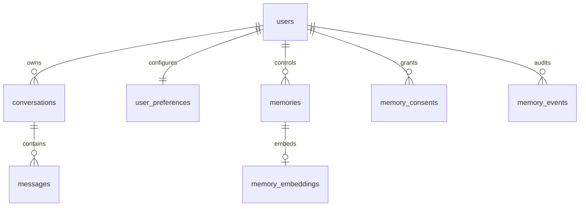

# Database schema

Typed SQLAlchemy models are in `backend/app/db/models.py`; Alembic is the schema deployment mechanism. Revisions `0001_initial` and `0002_memory` create users, conversations, messages, preferences, memories, consent and event tables. `0003_memory_metadata` adds provenance and consent timestamps. `0004_pgvector` enables pgvector and creates a separate, owner-scoped `memory_embeddings` table with 768-dimensional vectors and an HNSW cosine index. PostgreSQL is the source of truth; Firebase is used for authentication only.

Every conversation operation filters by both conversation UUID and the verified PostgreSQL user UUID. Messages inherit ownership through their parent conversation. Memory reads and writes include the verified owner. Foreign keys cascade on account deletion, although a coordinated Firebase account deletion endpoint still needs implementation.

The historical `backend/schema.sql` describes the former Supabase schema and is not used by the application. Local PostgreSQL is currently at `0003_memory_metadata`; `0004_pgvector` awaits installation of the server extension. The migration is optional. Before it is successfully applied, application flows use lexical retrieval and do not read or write `memory_embeddings`, even if the vector flag is accidentally enabled; runtime checks require both the flag and the extension/table to exist.
